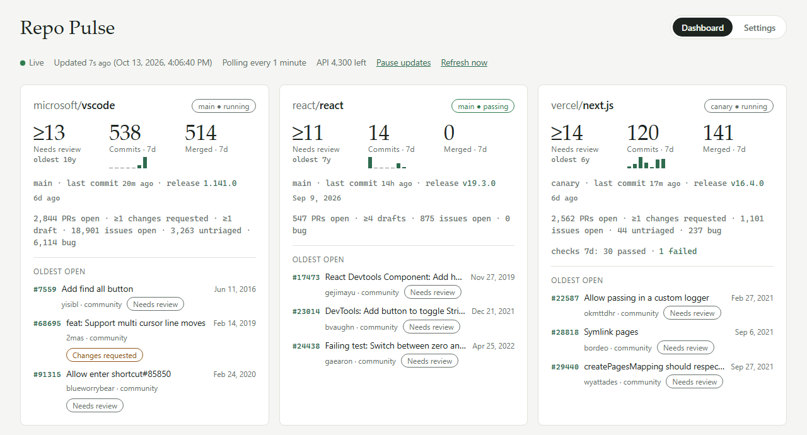
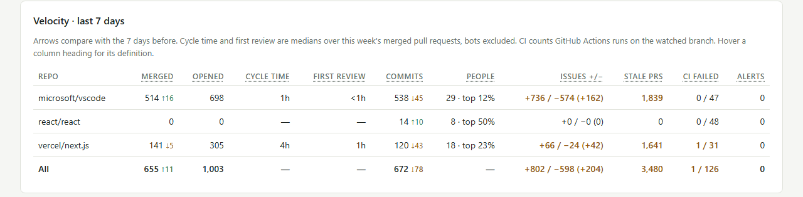
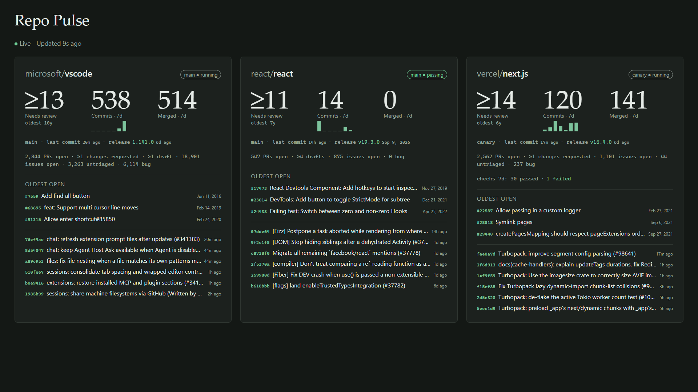

# Repo Pulse

A live dashboard for up to three GitHub repositories under any organization or user your token can see. It answers, at a glance, whether code is moving and whether anything is waiting on you: pull requests that need review, failing checks on the default branch, what shipped last, and what landed in the past week. It's one Node.js file plus one HTML file, no dependencies, no build step, and it runs on Windows, macOS and Linux.

<picture>
  <source media="(prefers-color-scheme: dark)" srcset="docs/images/cards-dark.png">
  
</picture>

The velocity table under the cards compares this week with last, per repository and in total:

<picture>
  <source media="(prefers-color-scheme: dark)" srcset="docs/images/velocity-dark.png">
  
</picture>

TV mode fills a wall display with the cards and the latest commits:



The screenshots show public repositories; the full dashboard in [dark](docs/images/dashboard-dark.png) and [light](docs/images/dashboard-light.png), and the [Settings tab](docs/images/settings.png), are in `docs/images`. There is also a [product page](https://evansmith-everag.github.io/repo-pulse/) built from the same files.

## Download and run

1. Install [Node.js](https://nodejs.org) 22 or newer (18 and 20 have reached end of life).
2. Download the latest `repo-pulse-vX.Y.Z.zip` from the Releases page and unzip it.
3. Give it a GitHub token. Either set `GITHUB_TOKEN` (or `GH_TOKEN`), or sign in with the [GitHub CLI](https://cli.github.com) (`gh auth login`) and the server will use that login. See "Which token is used" below.
4. Start it:
   - Windows: double-click `start.cmd`
   - macOS or Linux: open a terminal, `cd` into the unzipped folder, run `sh start.sh` (no `chmod` needed)
   - anywhere: `node server.js` (or `npm start`)

   The start scripts open http://127.0.0.1:4317 in your browser. `node server.js` prints the address. The console also prints which token it is using and for which account, for example `token: GitHub CLI login (gh auth token) as @you`.
5. The dashboard shows three setup steps. Open **Settings**, enter a GitHub organization or user (or press "Use my account"), press **Load repositories**, pick up to three, and save.

Settings are kept in `config.json` next to `server.js`; the last fetched data is kept in `snapshot.json` beside it so a restart shows data immediately. When you upgrade (or edit the page), every open dashboard notices the new version on its next update and reloads itself; a Settings tab with unsaved edits waits and shows a Reload link instead.

### Repositories, owners and branches

Each entry in the list is one of:

- `name`: a repository under the organization or user you entered.
- `owner/name`: a repository under any other owner, so one dashboard can mix repositories from several organizations and users.
- `name@branch` or `owner/name@branch`: watch a branch other than the default. Commits, the checks chip, the week's shape and the last-commit age all follow that branch; PR, issue and merged counts are for the whole repository.

Pick from the loaded list or type any of these into **Add by name**. The same grammar works in `config.json`:

```json
{ "org": "my-org", "repos": ["api", "web@release/2.x", "partner-org/sdk"], "issueLabels": ["bug"] }
```

## What the dashboard shows

Each repository card:

- **A checks chip** for the default branch: `main ● passing`, `● failing` (the card also gets a red top edge) or `● running`. Repos with no checks show no chip.
- **Three numbers:** pull requests that **need review** (open, not draft, nobody has approved or asked for changes yet) with the age of the oldest one; **commits in the last 7 days** on the watched branch, with a seven-bar shape of the week beneath it; **pull requests merged in the last 7 days**. A `≥` means the review count covers only the 15 oldest open PRs.
- **A meta line:** branch, age of the last commit, and the latest release with its age.
- **A counts line:** PRs open, approved, changes requested, drafts, issues open, **untriaged** issues (open, no label, no comments), and the open-issue count for each label you list under **Issue labels to count** in Settings (up to five, for example `bug` or `help wanted`).
- **Oldest open:** the three oldest non-draft PRs with author, review state, and a marker for first-time or community contributors.
- **Quiet** (no commit in 30 days), **Slowing** (8 to 30 days), **Archived** or **Unavailable** chips when they apply. Active repos get no chip; silence is the good state.

When checks failed on the watched branch this week, the card adds a line such as `checks 7d: 42 passed · 6 failed · failing now: Nightly`, with the failure count linking to the latest failed run. Open Dependabot security alerts appear on the card too when the token may read them.

### Velocity

Below the cards, a **Velocity · last 7 days** table gives the numbers a manager asks for, computed fresh from GitHub on every poll (nothing is stored, so a new install shows a full week immediately). Arrows compare with the seven days before. Per repository, with a totals row:

- **Merged** and **Opened** pull requests.
- **Cycle time:** median time from opening to merge for the pull requests merged this week.
- **First review:** median time from opening to the first submitted review, for merged pull requests that got one.
- **Commits** on the watched branch.
- **People:** how many people committed, and the share of commits by the busiest one; 75 percent or more is highlighted.
- **Issues +/−:** opened and closed, with the net change to the backlog.
- **Stale PRs:** open, non-draft pull requests older than 14 days.
- **CI failed:** failed out of total GitHub Actions runs on the watched branch, followed by any workflow whose latest run failed.
- **Alerts:** open Dependabot security alerts.

Bots (`dependabot`, `renovate`, anything ending in `[bot]` or `-bot`) are left out of the people column and the two medians, because a dependency bot is otherwise the "top contributor" and an auto-merge bot has a one-minute cycle time. Hover a column heading for its definition, or open "Column definitions" under the table. The table is hidden in TV mode and can be turned off per browser (or with the `v` key).

Below the cards, **Recent commits** merges up to five of the latest commits per repository, newest first. New rows are tagged "new" until the next update, and numbers that changed show their delta (for example `↑2`) until then.

The **status strip** shows whether the page is live, "Updated 28s ago" with the exact local time beside it, the poll interval, the GitHub API budget left this hour, and Pause and Refresh buttons. If the data is older than two poll intervals an amber bar says how old it is and the cards dim. If GitHub rejects the token the dot turns red and a banner says what to do. If GitHub rate-limits the server the bar says when polling resumes.

### TV mode

Open `http://127.0.0.1:4317/?tv=1` on a wall display: the layout fills the screen, type is larger, the commit feed is replaced by commits inside each card, and the navigation is hidden. Add `&theme=light` or `&theme=dark` to force a theme; TV mode defaults to dark.

### This browser

The Settings tab has a "This browser" panel for preferences that live in the browser, not in the shared settings: theme (system, light, dark), reduce motion, hide commits by bots, announce changes to screen readers, browser notifications for new pull requests and failing checks, and whether the velocity table is shown. Each live update cross-fades into place in browsers with view transitions; "reduce motion" (or the system setting) makes it a plain swap. The theme override drives the page's `color-scheme`, so native controls and scrollbars follow it. Keyboard shortcuts: `r` refresh, `p` pause, `d` dashboard, `s` settings, `t` cycle theme, `v` velocity table.

## Which token is used

The server looks for a token in this order: `GITHUB_TOKEN`, `GH_TOKEN`, then `gh auth token` from the GitHub CLI. It never shows the token anywhere, but it does tell you which source and which account are in use, in the console at startup, in the setup steps, and in the Settings tab.

- **Public repositories only:** any token works; a classic token needs no scopes, a fine-grained token needs only the default public read access.
- **Private repositories:** a classic token with the `repo` scope, or a fine-grained token with read access to Contents, Issues, Pull requests and Metadata for the repositories you pick. Add Actions read access for the CI column and Dependabot alerts read access for the Alerts column; without them those columns show a dash. Fine-grained tokens expire; when one does, the dashboard stops polling and says so.
- The `gh` login is convenient but usually carries more scope than this tool needs. If that bothers you, create a read-only fine-grained token and set `GITHUB_TOKEN`.

The token is read once at startup, so restart after rotating it.

## How it stays live

- **Polling:** every `pollSeconds` (default 60; the Settings dropdown offers 15 s to 1 hour) the server makes two GraphQL requests in parallel, one for the cards and one for the velocity searches, plus one REST call per repository for its Actions runs. Together they cost about 2 points of the token's 5,000-points-per-hour GraphQL budget and one call per repository from the separate 5,000-per-hour REST budget; the status strip shows the GraphQL points left. GitHub answers in about 4 to 6 seconds for busy repositories. If the velocity request or an Actions call fails, only those cells go blank; the cards still update.
- **Backoff:** after a failed poll the interval doubles (with jitter) up to 30 minutes. A rate-limit answer pauses polling until the time GitHub gives. A rejected token stops polling until you restart with a new one; "Refresh now" still retries.
- **Push to browser:** open pages get each new snapshot over server-sent events (`/api/events`). If the page loses the server it says so and reconnects on its own.
- **Webhooks (optional):** set `WEBHOOK_SECRET` and point a GitHub webhook (content type `application/json`; events: push, issues, pull requests, pull request reviews, check suites, workflow runs, statuses, releases) at `https://<host>/webhook`. The server checks the signature, ignores replayed delivery ids, and refreshes within a few seconds. Webhooks need the server to be reachable from GitHub, so they only work on a web server, not on localhost.

## Updates

The server checks this project's GitHub releases about ten seconds after it starts and then about once a month, and says so in the console. When a newer release exists, the dashboard shows a bar with the version, a link to the release notes and an **Update now** button; the Settings tab has an **Updates** panel with the same plus **Check now**.

Updating downloads the release zip and `SHA256SUMS` from GitHub, verifies the checksum, replaces `server.js`, `public/index.html`, `package.json`, `README.md` and `LICENSE` in place (the previous copies go to `.previous/`), and exits with code 75. `start.cmd` and `start.sh` start the server again on that code, systemd does with `Restart=on-failure`, and Docker does with `--restart unless-stopped`. Open dashboards show "Restarting after the update" and reload themselves when the new version is up. If you ran `node server.js` by hand, start it again. The launcher scripts are never replaced by an update, since Windows reads a running batch file as it goes; download a release zip when you want new launchers.

Installing is an administrative action: it needs the admin token when `ADMIN_TOKEN` is set, and otherwise only works from the machine the server runs on. It refuses inside the Docker image (pull the newer image instead), inside a git checkout (`git pull` instead), and when the install folder isn't writable, which is the case under the systemd unit above unless you add `ReadWritePaths=/opt/repo-pulse`. To roll back, copy the files from `.previous/` over the current ones and restart.

Set `UPDATE_CHECK=0` to turn the checks off; the only request they make is to GitHub's releases API for this repository. A fork can point them at its own releases with `UPDATE_REPO=owner/name` or the `repository` field in `package.json`.

## Endpoints for scripts

- `GET /api/snapshot` returns the same JSON the page receives, with an `ETag`; send `If-None-Match` to get a `304` when nothing changed.
- `GET /healthz` returns `200 {ok: true, …}` when the token works and data has been fetched, otherwise `503`. Use it for Docker health checks or uptime monitors.
- `GET /api/update` returns the running version and the latest release seen; `POST /api/update/check` checks now; `POST /api/update` installs the latest release (admin token when set, otherwise from the server's own machine only).

## Environment

| Variable | Default | Purpose |
|---|---|---|
| `PORT` | `4317` | Listen port |
| `HOST` | `127.0.0.1` | Bind address. Keep it on loopback behind a reverse proxy; use `0.0.0.0` only when nothing fronts it |
| `GITHUB_TOKEN` / `GH_TOKEN` | from `gh` | GitHub token; see "Which token is used" |
| `ADMIN_TOKEN` | none | If set, saving settings and listing an owner's repositories require it (entered in the Settings tab) |
| `WEBHOOK_SECRET` | none | Enables `POST /webhook` |
| `ALLOWED_HOSTS` | none | Comma-separated host names that may reach the server besides localhost, for example `pulse.example.com` behind a proxy |
| `TRUST_PROXY` | off | Set `1` behind a proxy that rewrites `Host`; the server then reads `X-Forwarded-Host` for its same-origin check |
| `MAX_REPOS` | `3` | How many repositories can be picked (1 to 9). Three is the glanceable number; more repositories mean a slower poll |
| `REPO_PULSE_CONFIG` | `./config.json` | Config file location |
| `REPO_PULSE_CACHE` | `snapshot.json` next to the config | Where the last fetched data is kept |
| `REPO_PULSE_FIXTURE` | none | A JSON file of canned rows served instead of GitHub (used by the tests; see `test/fixture.json`) |
| `UPDATE_CHECK` | on | Set `0` to stop checking GitHub releases for a newer version |
| `UPDATE_REPO` | from `package.json` | `owner/name` whose releases to check, for forks |
| `REPO_PULSE_CONTAINER` | set by the Dockerfile | Tells the server it is an image, so "Update now" says to pull instead |

`config.json` can be edited by hand while the server is stopped. If it can't be parsed, the server starts with defaults in memory, leaves the file alone, and shows the problem in the Settings tab; the next save rewrites the file.

## Running it for a team

Keep the server on loopback and put a reverse proxy with HTTPS (and ideally your SSO) in front of it. Set `ADMIN_TOKEN` so viewers cannot change settings or browse the owner's full repository list.

Caddy keeps the `Host` header and streams server-sent events as is:

```
pulse.example.com {
    reverse_proxy 127.0.0.1:4317
}
```

Run the server with `ALLOWED_HOSTS=pulse.example.com`. For nginx, which rewrites `Host` by default, either add `proxy_set_header Host $host;` or run with `TRUST_PROXY=1`, and add `proxy_buffering off;` so the event stream is not buffered.

A systemd unit for a Linux box, Raspberry Pi or NAS (the `gh` fallback will not exist there, so set the token in the environment file):

```
[Unit]
Description=Repo Pulse
After=network-online.target

[Service]
DynamicUser=yes
StateDirectory=repo-pulse
EnvironmentFile=/etc/repo-pulse.env
Environment=REPO_PULSE_CONFIG=/var/lib/repo-pulse/config.json
ExecStart=/usr/bin/node /opt/repo-pulse/server.js
Restart=on-failure

[Install]
WantedBy=multi-user.target
```

with `/etc/repo-pulse.env` (mode 0600) holding `GITHUB_TOKEN=…`, `ADMIN_TOKEN=…` and `ALLOWED_HOSTS=…`. On Windows, Task Scheduler with "run at log on" pointing at `start.cmd` does the same job.

### Docker

```sh
docker build -t repo-pulse .
docker run -d --name repo-pulse -e GITHUB_TOKEN=… -p 127.0.0.1:4317:4317 -v repo-pulse-data:/data repo-pulse
```

The image listens on all interfaces inside the container (there is no loopback to bind to from outside), so publish the port on `127.0.0.1` as above or put a proxy in front, and set `ADMIN_TOKEN` if other people can reach it. Settings and the data cache live in the `/data` volume. The container reports health through `/healthz`. There is no `gh` inside the image, so the token must come from the environment.

## Who can see what, and what leaves your machine

Anyone who can reach the server sees the dashboard data for the chosen repositories, fetched with the server's token. With `ADMIN_TOKEN` set, changing settings and browsing an owner's full repository list (names, descriptions, push times for every repository the token can see) need the token; without it, anyone who can reach the page can do both.

When bound to localhost (the default) the server rejects requests whose `Host` header isn't a loopback address or in `ALLOWED_HOSTS`, and it rejects state-changing requests that a browser marks as cross-site. That keeps other websites open in your browser from reading or changing anything. Responses carry a strict content security policy and the page uses system fonts, so the only network traffic is to GitHub: `api.github.com` for polling and update checks, plus GitHub's release download when you press Update now.

## Tests

```sh
npm test              # both suites; or npm run test:server / npm run test:ui
```

Both suites start their own servers on `TEST_PORT` (default 4399, and the next port up) with throwaway files in the temp directory, so a running instance and your own `config.json` are untouched. `test/verify-server.mjs` covers request validation, auth, webhooks, refresh queueing and throttling, config and cache handling, rejected tokens, proxy support and fixture mode; it needs a GitHub token for the runs against live GitHub, or `TEST_LIVE=0` to skip them. `test/verify-ui.mjs` drives the real page in headless Edge or Chrome over the DevTools protocol against both a fixture server and live GitHub; set `REPO_PULSE_BROWSER` if the browser isn't in a standard location. CI runs the server suite against live GitHub on Node 22 (the oldest supported line, taken from `engines` in `package.json`), and on Node 26 the server suite in fixture mode plus the browser suite, for every push to `main` and every pull request, using the workflow's own token.

## Releases

Push a tag like `v1.2.0` and the release workflow zips `server.js`, `public/`, the start scripts, `package.json`, `README.md` and `LICENSE` into `repo-pulse-v1.2.0.zip`, writes `SHA256SUMS`, and attaches both to a GitHub Release with generated notes. The `Dockerfile` builds from the same files.

## License

Public domain, under the Unlicense. See `LICENSE`.
